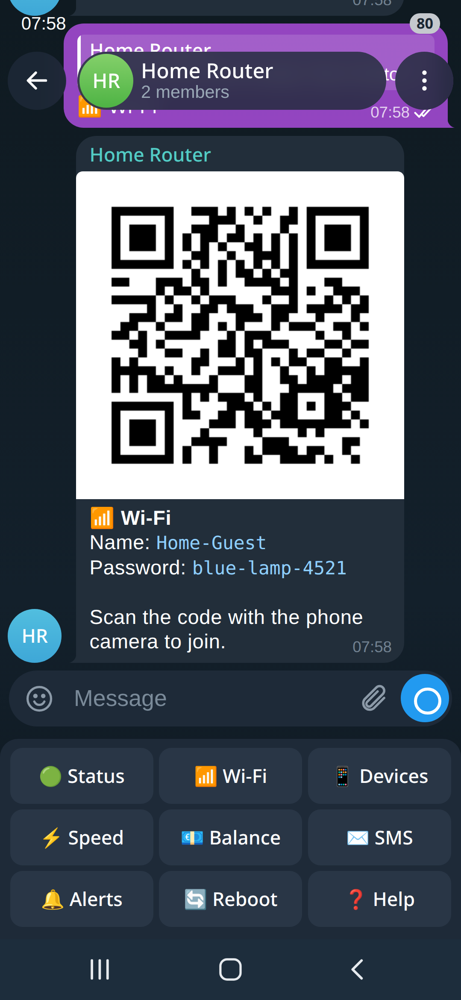

# lonewrt

lonewrt builds an OpenWrt image for the ZTE MF289F, an LTE router, meant for a place where nobody looks after it.
You describe one router in a profile file and build a flashable image from it.
The router comes back configured after a button reset, restarts a hung link by itself, and reports to you over Telegram and SMS.

The image is experimental: it runs on one router in daily use, so expect rough edges on other setups.

What the chat looks like, with the keyboard that saves remembering commands (made-up data):

  

## What it solves

For a router you cannot walk up to: a rental flat, a holiday home, a cabin, a small office. Guests use the Wi-Fi and nobody on site can fix it.

- **A guest presses reset.** The settings live in the image, so the router comes back as you configured it, not as bare OpenWrt. Changes made later in LuCI go with the reset, and so do the logs and the SMS archive on the router.
- **The modem hangs.** The router restarts the connection, then the whole router, waiting longer each time. It stops when a restart cannot help: a used-up data package or a SIM asking for its PIN. When LTE stays dead it switches to 2G, enough for the tunnel and the bot.
- **The data package expires and you learn it a week later.** Every SMS on the SIM is posted to your Telegram chat. An SMS that arrives during an outage is posted once the internet is back. With a preset for your operator the router also checks the balance once a week and warns you when it is low.
- **Someone asks for the Wi-Fi password at 23:00.** You tap a button in Telegram and the bot posts the Wi-Fi name and password with a QR code that a phone camera scans to join. Other buttons give the link state, the connected devices, the newest SMS, a speed test (about 330 MB of your data) and a restart.
- **The internet is down and so is the bot.** A healthchecks.io heartbeat tells you from the outside, and the router posts when it is back and how long it was gone.
- **Telegram is not an option.** Phone numbers you list can text `status` or `reboot` to the SIM. The router checks only the sender's number, and numbers can be faked, so SMS can only ask for the state and a restart, 5 restarts a day by default.
- **You want to reach the router yourself.** Through a WireGuard tunnel to your own server, or through Tailscale with no server at all, you open its settings page and SSH from your laptop or phone. Optional, see [Remote access](#remote-access).

## What you need

- A ZTE MF289F that already runs OpenWrt. The build targets OpenWrt 25.12.6.
- Either a Linux x86_64 build host, or no Linux at all: a web browser, a GitHub account and the router's web page (LuCI), see [Build without Linux](#build-without-linux). The tools the Linux host needs are listed in [docs/development.md](docs/development.md#build-host).
- For the notifications, a Telegram bot token and a chat. For remote access, your own WireGuard server or a free Tailscale account, see [Remote access](#remote-access). For the heartbeat, a healthchecks.io check. Each is optional.

| You have | Start at |
|---|---|
| A Linux x86_64 machine | [Quick start](#quick-start) |
| Only a web browser and a GitHub account | [Build without Linux](#build-without-linux) |
| A coding agent (Claude Code, Codex and others) | [Flash with a coding agent](#flash-with-a-coding-agent) |

## Quick start

```sh
./fetch-deps.sh                      # ImageBuilder, packages, test rootfs into work/ (about 530 MB)
cp profiles/generic.conf profiles/mine.conf
$EDITOR profiles/mine.conf           # at least WIFI_COUNTRY; every key is explained in the file
./build.sh mine                      # image/mine-sysupgrade.bin, image/mine.manifest
```

Leave `WIFI_KEY`, `ROOT_PASSWORD` and `ROOT_PASSWORD_HASH` empty and the build generates random passwords and writes a password card to `image/mine-passwords.txt`.
Later builds of the same profile reuse the card, so the passwords stay.
Keep the card: the drawn passwords are stored nowhere else, and without it the next build draws new ones.

Then back up the router and flash. The examples use `192.168.1.1` for the router's current address:

```sh
ssh root@192.168.1.1 'sysupgrade -b -' > backup.tar.gz
scp -O -r root@192.168.1.1:/root ./router-root                 # logs and SMS archive
scp -O image/mine-sysupgrade.bin root@192.168.1.1:/tmp/fw.bin
ssh root@192.168.1.1 'sysupgrade -T /tmp/fw.bin && sysupgrade -n /tmp/fw.bin'
```

The flash cuts your connection, so do not run it over the router's own Wi-Fi unless you can afford to lose it.
To go back, flash any other OpenWrt sysupgrade image the same way and restore the backup with `sysupgrade -r`.

This model has no failsafe for a broken image: the way back is opening the case and a serial console ([docs/development.md](docs/development.md), "Recovery"). That is why `sysupgrade -T` checks the image before the flash. The image also keeps the official kernel and only adds packages and files on top.

You can also write the profile in the configurator, a web page in one file: open `configurator/index.html` from disk in a browser, or use the hosted copy at https://damianpala.github.io/lonewrt/ (it sends nothing either way).

## Build without Linux

You need a GitHub account, a web browser and a ZTE MF289F that already runs OpenWrt. The image is built on GitHub's machines from your own profile and you flash it in LuCI, the router's settings page.
Releases hold no ready image: an image without your profile would have no bot and would give everyone the same passwords.
The profile holds your Wi-Fi and root passwords, so everything below is private: your repository, the saved profile file and the download.

1. **Make your repository from the template.** Open [DamianPala/lonewrt-build](https://github.com/DamianPala/lonewrt-build), click **Use this template** > **Create a new repository**, and choose **Private**. A run in a public repository stops before it builds anything, because every signed-in GitHub user can download what a public repository's run makes.
2. **Fill in the configurator.** Open https://damianpala.github.io/lonewrt/. It runs in your browser and sends nothing. Read the release version the page shows at its top: you build that version in step 4. Go through the fields (each one is explained), and **set both passwords**: the Wi-Fi password (`WIFI_KEY`) and the root password (`ROOT_PASSWORD`); a button at each field draws one for you. A build on GitHub draws no password, so that every build gives you the same ones; a profile without them is refused.
3. **Save the profile and keep it.** Click **Save as a file** (it makes `router.conf`) and keep that file somewhere private: it holds your passwords, and the configurator of a later release loads it, so you never fill the form from scratch again. Then put its text into GitHub: in your new repository open **Settings > Secrets and variables > Actions > New repository secret**, name it `LW_PROFILE`, open the saved file in a text editor, copy all of it and paste it as the value.
4. **Run the build.** Open **Actions > build > Run workflow**. In **version** type the release version the configurator page showed (empty means the newest release, which may be newer than the page you used). Leave **name** as `router` and **test** unticked. It takes some minutes. If it stops, its message names the problem (a missing secret, a profile key, an empty password); nothing is uploaded then.
5. **Download the image.** Open the green run and download the artifact at the bottom of the page. **It is kept for 7 days**, and the summary of the run names the last day. Unzip it: you get `router-sysupgrade.bin`, the image, and `router.manifest`, the package list. The summary also gives the image's sha256 (a fingerprint of the file) for the check below.
6. **Back up the router.** In LuCI open **System > Backup / Flash Firmware** and click **Generate archive**. Keep the file: it can restore your old settings.

To move to a newer release, load your saved profile into the configurator of that release, save it again, update the secret and run the build with the new version.

Then flash, in one of two ways.

### Flash in LuCI

1. In LuCI open **System > Backup / Flash Firmware** and next to **Flash new firmware image** click **Flash image...**, then choose `router-sysupgrade.bin`.
2. LuCI shows the size and the checksum of the file. Compare the checksum with the sha256 in the run's summary. If they differ, stop and download again.
3. **Untick "Keep settings"** (the wording differs a little between versions). Without it the router takes everything from your profile, as after a button reset. This is what `sysupgrade -n` does in the commands of the Quick start.
4. Click **Continue** and leave the router alone. Use a cable if you can, because the Wi-Fi drops while it flashes.

Tried on an MF289F flashed from OpenWrt 25.12.6 (lonewrt 0.2.1): after the upload LuCI checks the image with `sysupgrade --test`, and with "Keep settings" unticked it runs `sysupgrade -n`.
An image built on GitHub has not been flashed this way yet.
LuCI refuses an image that does not fit the router, but this model has no failsafe for a broken one.

### Flash with a coding agent

Give a coding agent (Claude Code, Codex and others) the file [skills/lonewrt/SKILL.md](skills/lonewrt/SKILL.md) and your saved profile file, and tell it what you want: "build my image on GitHub and flash it". It builds from your file without printing your passwords, makes a backup, checks the image and flashes only when you say yes to that flash. It needs `ssh` access to the router with a key, and it never asks you for a password in the chat.
## After flashing

These are the hints that the password card carries when the build draws a password.
A build on GitHub writes no card, because both passwords are the ones you put in your profile, so the hints are here, for you and for whoever gets the router.
The router's own settings page is called LuCI.

- **Wi-Fi.** The network name is `WIFI_SSID` of the profile and the password is `WIFI_KEY`. It is one network on both the 2.4 and the 5 GHz band.
- **Opening LuCI.** Join the router's Wi-Fi or plug a cable into its LAN port, and open `https://` followed by the router's address (`LAN_IP` of the profile, `192.168.1.1` unless you changed it) in a browser. The user is `root`; the password is `ROOT_PASSWORD` of the profile, or the password behind `ROOT_PASSWORD_HASH` if you gave a hash.
- **The browser warns about the certificate.** This is expected: the router signs its own certificate, so the browser cannot know it. Choose Advanced and continue.
- **The button reset.** Holding the router's reset button puts back the settings of the image, passwords included: the ones of your profile. Changes you made later in LuCI, the logs and the SMS archive on the router are lost.
- **A SIM card with a PIN.** Take the PIN off in a phone, or put it into your profile (`WWAN_PIN`) and build again. A PIN entered in LuCI (Network > Interfaces > WWAN > Edit > PIN) is lost at the next flash or button reset.
- **No internet 5 minutes after the router starts.** Enter your operator's APN (the mobile data name, on the operator's site) in LuCI: Network > Interfaces > WWAN > Edit > APN, then Save & Apply.
- **LTE first.** The router works on LTE and sets it again at every start. Only when LTE stays dead after a restart does it switch to 2G (EDGE) for a while, and the bot tells you. The network mode cannot be changed for good in LuCI: the next start sets LTE again.
- **The router restarts itself.** When the internet fails, it first restarts the connection, then, if that does not help, the whole router. To turn the restarts off, go to LuCI: System > Scheduled Tasks and delete the line with `/usr/sbin/wwan-recover`.
- **SMS in the modem.** When it holds more than 30 messages, the router copies all of them to `/root/sms-archive/` once a day at 04:10 and deletes the oldest, keeping 20, so new SMS (top-ups, package expiry) keep arriving.
- **The Wi-Fi country.** It is the `WIFI_COUNTRY` of the profile. To change it without a new image, go to LuCI: Network > Wireless > Edit on each radio > Advanced Settings > Country Code.
- **SSH warns that the host key changed.** Expected after every flash and button reset, because the router gets a new key. Run `ssh-keygen -R <router address>` and connect again.

## Remote access

WireGuard and Tailscale each open the router's settings page (LuCI) and SSH from afar. Both are off by default, and you can turn on either one or both.

- **WireGuard**, through a server you run: set `WG_ENABLED='1'` and the other `WG_*` keys ([docs/profile.md](docs/profile.md)).
- **Tailscale**, with no server of your own: set `TS_ENABLED='1'`, then sign in with a link that comes by Telegram, SMS or SSH ([Tailscale guide](docs/tailscale.md)).

Whoever steals the router gets its key into your network, so limit what it can reach there.
On your WireGuard server, allow the router's peer only its own tunnel address and block its connections into your network ([docs/network.md](docs/network.md)).
In Tailscale, **[limit what the router can reach](docs/tailscale.md#limit-what-the-router-can-reach) in your account's access policy**.

## Limits

- **Only the MF289F.** Another LTE router that runs OpenWrt can be a starting point too, with a fork and some work: see [docs/porting.md](docs/porting.md).
- **OpenWrt must run already.** Installing OpenWrt over the stock firmware is not covered here.
- **No button recovery.** A broken image means opening the case and a serial console, so do not use lonewrt on a router you cannot afford to open.
- **IPv4 only.** The router asks the operator for an IPv4 address only, so an operator that gives only IPv6 (for example Orange or Bouygues in France by default) does not work yet.
- **Settings live in the image.** A button reset brings back the profile's settings, so a lasting change means a new build and a flash.

## Docs

- Reference for the profile keys: [docs/profile.md](docs/profile.md).
- Set up remote access and its access policy with [Tailscale](docs/tailscale.md).
- Balance checks for your operator: [docs/operators.md](docs/operators.md).
- What ends up in the image: [packages.md](packages.md).
- What changed in each release: [CHANGELOG.md](CHANGELOG.md).
- The full behaviour, with reasons, is in [SPEC.md](SPEC.md).
- Another router: [docs/porting.md](docs/porting.md) lists what stays, what changes and what to measure again.

## For agents

A coding agent that builds and flashes a person's image follows the agent skill [skills/lonewrt/SKILL.md](skills/lonewrt/SKILL.md).

## Contributing

Solo project, best effort, no response-time promise. Built with AI coding agents under my direction.

- Bugs: open an issue with the OpenWrt version, the contents of `/etc/lw-build`, what you did and expected, and the `lw-` lines of `logread`. Remove phone numbers, tokens and keys first.
- Pull requests for bug fixes are welcome; open an issue first for anything larger.
- Working on the code: [docs/development.md](docs/development.md) for layout and tests, [AGENTS.md](AGENTS.md) if a coding agent does the typing.

## Security and privacy

Security: use "Report a vulnerability" on the Security tab, not a public issue.
The build sends nothing about your profile anywhere, and there is no telemetry. The router talks to the operator and the NTP pool, and pings `8.8.8.8` and `1.1.1.1` to check the link. It also talks to what your profile turns on: Telegram, healthchecks.io, speedtest.net, your WireGuard server, Tailscale.

[What goes over the network](docs/network.md) lists each destination, what it gets, and why a built image stays private.

## Licence

Licence: MIT, see [LICENSE](LICENSE). The packages the ImageBuilder puts into the image keep their own licences.
