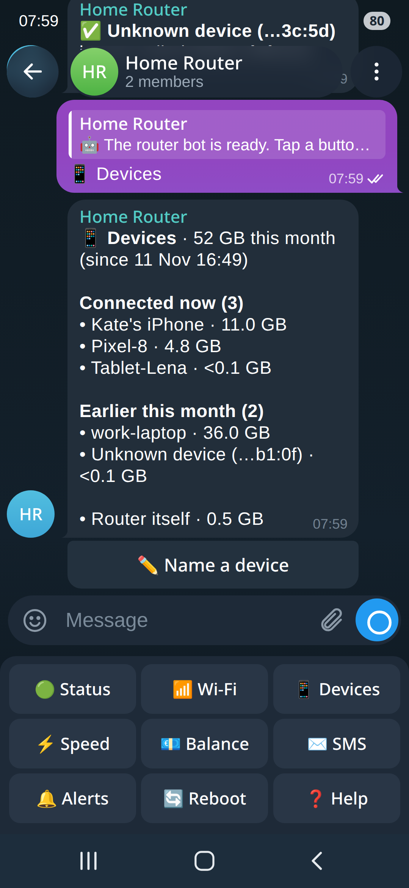

# lonewrt

lonewrt builds an OpenWrt image for the ZTE MF289F, an LTE router, meant for a place where nobody looks after it.
You describe one router in a profile file and build a flashable image from it.
The router comes back configured after a button reset, restarts a hung link by itself, and reports to you over Telegram and SMS.

I built it for a flat abroad with guests and no admin on site. What it fixes:

- **A guest presses reset.** The settings live in the image, so the router comes back as you configured it, not as bare OpenWrt. Changes made later in LuCI go with the reset, and so do the logs and the SMS archive on the router.
- **The modem hangs.** When the network only drops the data session, a small watcher starts it again within seconds. Otherwise the router restarts the connection, then the whole router, waiting longer each time. It gives up restarting when a restart cannot help: a used-up data package or a SIM asking for its PIN. When LTE stays dead it switches to 2G where the network still has it, enough for the tunnel and the bot, not for video, and back to LTE once that works again.
- **The data package expires and you learn it a week later.** Every SMS on the SIM is posted to your Telegram chat. An SMS that arrives during an outage is posted once the internet is back. With a preset for your operator the router also checks the balance once a week and warns you when it is low. One preset is included, Telekom Montenegro; yours is a 7-line data file.
- **Someone asks for the Wi-Fi password at 23:00.** You tap a button in Telegram and the bot posts the Wi-Fi name and password with a QR code that a phone camera scans to join. Other buttons give the link state, the connected devices, the newest SMS, a speed test (about 330 MB of your data) and a restart. Typed commands do the same: `/status`, `/wifi`, `/devices`, `/sms`, `/speedtest`, `/balance`, `/alerts`, `/reboot`, `/help`.
- **The internet is down and so is the bot.** A healthchecks.io heartbeat tells you from the outside, and the router posts when it is back and how long it was gone.

What the chat looks like, with the keyboard that saves remembering commands (made-up data, rendered from the bot's code by `tools/tg-preview`):

  

Phone numbers you list can also text `status` or `reboot` to the SIM, for the day Telegram is not an option.
The router checks only the sender's number, and numbers can be faked. So SMS can only ask for the state and a restart, and restarts by SMS are limited to 5 a day.

The image is experimental. It runs on one router in daily use; expect rough edges on other setups.
The full behaviour, with reasons, is in [SPEC.md](SPEC.md).

## What you need

- A ZTE MF289F that already runs OpenWrt. Installing OpenWrt over the stock firmware is not covered here.
- A Linux x86_64 build host with `bash`, `python3`, `openssl`, `curl`, `tar`, `zstd`, `make`, `flock` and GNU awk. The tests also want `bubblewrap`, `squashfs-tools`, `qrencode` and `zbar-tools`. Details in [docs/development.md](docs/development.md).
- For the notifications, a Telegram bot token and a chat. For remote access, a WireGuard server. For the heartbeat, a healthchecks.io check. Each is optional.

## Quick start

```sh
./fetch-deps.sh                      # ImageBuilder, packages, test rootfs into work/ (about 530 MB)
cp profiles/generic.conf profiles/mine.conf
$EDITOR profiles/mine.conf           # at least WIFI_COUNTRY; every key is explained in the file
./build.sh mine                      # image/mine-sysupgrade.bin, image/mine.manifest
```

Leave `WIFI_KEY`, `ROOT_PASSWORD` and `ROOT_PASSWORD_HASH` empty and the build generates random passwords and writes a password card to `image/mine-passwords.txt`.
Later builds of the same profile reuse the card, so the passwords stay.
Keep the card: the drawn passwords are stored nowhere else, and without it the next build draws new ones.
To choose the root password yourself, write it in `ROOT_PASSWORD`; the build puts only its hash into the image.

Then back up the router and flash. The examples use `192.168.1.1` for the router's current address:

```sh
ssh root@192.168.1.1 'sysupgrade -b -' > backup.tar.gz
scp -O -r root@192.168.1.1:/root ./router-root                 # logs and SMS archive
scp -O image/mine-sysupgrade.bin root@192.168.1.1:/tmp/fw.bin
ssh root@192.168.1.1 'sysupgrade -T /tmp/fw.bin && sysupgrade -n /tmp/fw.bin'
```

The router is back after about 100 s, LTE and the tunnel about 70 s later.
The flash cuts your connection, so do not run it over the router's own Wi-Fi unless you can afford to lose it.
To go back, flash any other OpenWrt sysupgrade image the same way and restore the backup with `sysupgrade -r`.

This model has no failsafe for a broken image: the way back is opening the case and a serial console ([docs/development.md](docs/development.md), "Recovery"). That is why `sysupgrade -T` checks the image before the flash. The image also keeps the official kernel and only adds packages and files on top.

You can also write the profile in the configurator, a web page in one file: open `configurator/index.html` from disk in a browser (it sends nothing); a hosted copy will be on GitHub Pages.
Reference for the profile keys: [docs/profile.md](docs/profile.md).
Balance checks for your operator: [docs/operators.md](docs/operators.md).

## After flashing

These are the hints that the password card carries when the build draws a password.
A build on GitHub writes no card, because both passwords are the ones you put in your profile, so the hints are here, for you and for whoever gets the router.
The router's own settings page is called LuCI.

- **Wi-Fi.** The network name is `WIFI_SSID` of the profile and the password is `WIFI_KEY`. It is one network on both the 2.4 and the 5 GHz band.
- **Opening LuCI.** Join the router's Wi-Fi or plug a cable into its LAN port, and open `https://` followed by the router's address (`LAN_IP` of the profile, `192.168.1.1` unless you changed it) in a browser. The user is `root`; the password is `ROOT_PASSWORD` of the profile, or the password behind `ROOT_PASSWORD_HASH` if you gave a hash.
- **The browser warns about the certificate.** This is expected: the router signs its own certificate, so the browser cannot know it. Choose Advanced and continue.
- **The button reset.** Holding the router's reset button puts back the settings of the image, passwords included: the ones of your profile. Changes you made later in LuCI, the logs and the SMS archive on the router are lost.
- **A SIM card with a PIN.** The router cannot use it. Take the PIN off in a phone, or enter it in LuCI: Network > Interfaces > WWAN > Edit > PIN.
- **No internet 5 minutes after the router starts.** Enter your operator's APN (the mobile data name, on the operator's site) in LuCI: Network > Interfaces > WWAN > Edit > APN, then Save & Apply.
- **LTE only.** The router uses LTE and nothing else. The network mode (2G/3G/LTE) cannot be changed in LuCI: the router sets LTE again at every start.
- **The router restarts itself.** When the internet fails, it first restarts the connection, then, if that does not help, the whole router. To turn the restarts off, go to LuCI: System > Scheduled Tasks and delete the line with `/usr/sbin/wwan-recover`.
- **SMS on the SIM.** When the SIM holds more than 30 messages, the router copies all of them to `/root/sms-archive/` once a day at 04:10 and deletes the oldest, keeping 20, so new SMS (top-ups, package expiry) keep arriving.
- **The Wi-Fi country.** It is the `WIFI_COUNTRY` of the profile. To change it without a new image, go to LuCI: Network > Wireless > Edit on each radio > Advanced Settings > Country Code.

## What goes over the network

The build downloads the ImageBuilder and the official packages from `downloads.openwrt.org`, the modem tools `modemband` and `modemdata` from `dl.eko.one.pl`, the Polish OpenWrt site that packages them, and three LuCI apps for the modem, the bands and SMS from 4IceG's GitHub releases.
The ImageBuilder, the third-party packages and the test files are pinned by sha256 in `deps.lst`.
The official packages are downloaded by the ImageBuilder and checked with OpenWrt's signing keys, which come inside the pinned ImageBuilder.
The build sends nothing about your profile anywhere.
[packages.md](packages.md) lists what ends up in the image.

The router talks to the operator, the NTP pool and, depending on the profile:

| Destination | When | What it gets |
|---|---|---|
| `api.telegram.org` | Telegram keys set | SMS texts and senders, alerts, the replies to your commands (the Wi-Fi password among them) |
| your healthchecks.io URL | set | an empty GET every 5 minutes |
| `8.8.8.8`, `1.1.1.1`, DNS for `openwrt.org` | always | a ping and one lookup every few minutes, to tell whether the link works |
| the nearest speedtest.net server | you ask for a speed test | about 330 MB of test traffic |
| your WireGuard server | tunnel enabled | the tunnel |
| the operator's balance number | the weekly check and `/balance` | one SMS, which may cost money |
| your admin numbers | they text the router | one reply SMS each |

There is no telemetry.
The bot answers only in the chat from the profile, and anyone in that chat can read the Wi-Fi password and restart the router, so keep it to people you trust.
A profile with a Telegram token, a WireGuard key, a heartbeat URL or admin numbers makes a private image: those values sit in the image as root-readable files, so do not pass that image on.
Any built image carries its Wi-Fi password and root hash, so share the repository, not a built image, and build one image per router.

Whoever gets hold of the router also has its WireGuard private key.
So on your WireGuard server allow the router's peer only its own tunnel address, and block connections from it into your network; the router never needs them.

## Project

Solo project, best effort, no response-time promise.
Built with AI coding agents under my direction. The behaviour is pinned by the tests in `tests/`; [docs/development.md](docs/development.md) says what they cover and what only the real router can show.
The build targets OpenWrt 25.12.6; another release means updating the pins, also described there.

- Bugs: open an issue with the OpenWrt version, the contents of `/etc/lw-build`, what you did and expected, and the `lw-` lines of `logread`. Remove phone numbers, tokens and keys first.
- Security: use "Report a vulnerability" on the Security tab, not a public issue.
- Pull requests for bug fixes are welcome; open an issue first for anything larger.
- Working on the code: [docs/development.md](docs/development.md) for layout and tests, [AGENTS.md](AGENTS.md) if a coding agent does the typing.

Licence: MIT, see [LICENSE](LICENSE). The packages the ImageBuilder puts into the image keep their own licences.
